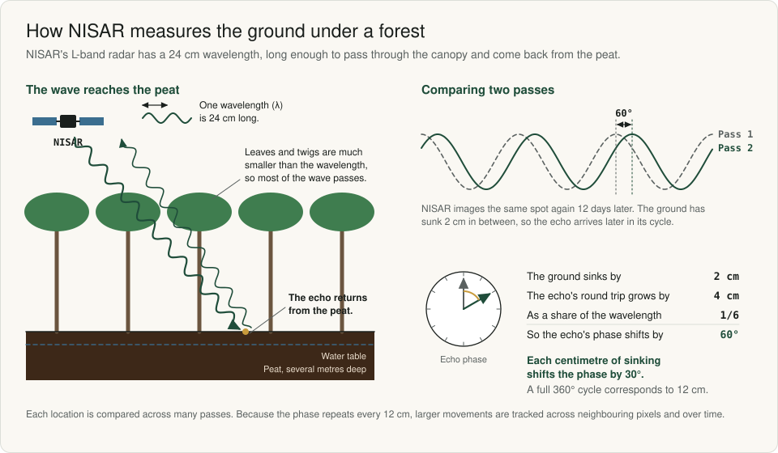
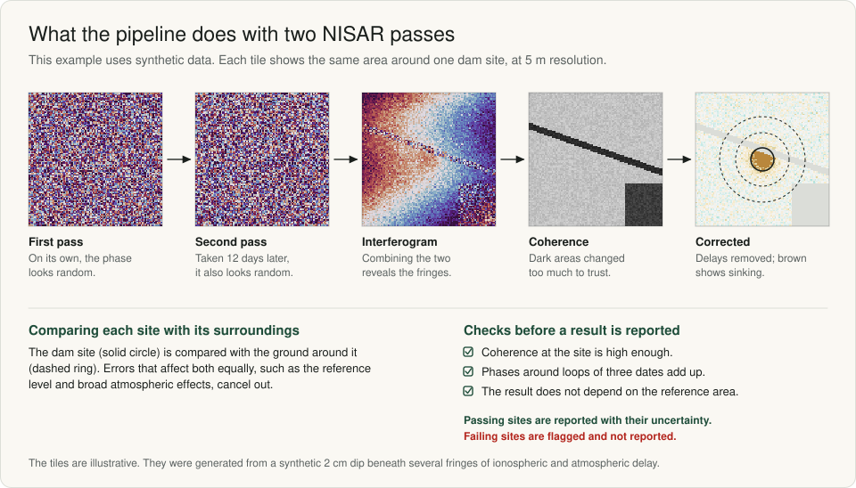
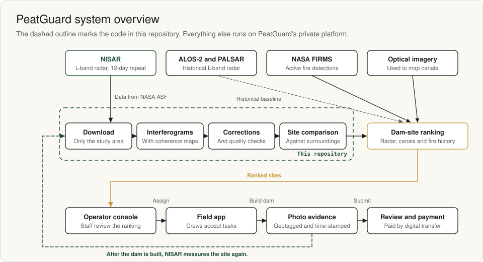

# PeatGuard

Satellite radar for village-led peatland restoration in Central Kalimantan, Indonesia.

Drained tropical peat dries out, sinks and burns. Blocking the old drainage canals rewets it, but
restoration crews need to know which canals to block first and funders need evidence that the
blocks worked. PeatGuard turns radar observations of the peat surface into a ranked list of
canal-blocking sites, dispatches them to village crews through a field app, and pays the crews
for verified work. The study area is the Sebangau landscape and the former Mega Rice Project.

This repository is the public showcase of the processing core: the NISAR L-band ingest,
time-series and validation code, with its test suite. The operator web console and the field
app are being rebuilt and are not included yet. The live site is [peatguard.com](https://peatguard.com).

## How it works



NISAR's L-band radar has a 24 cm wavelength. Leaves and twigs are much smaller than that, so
most of the wave passes through the canopy and comes back from the peat surface. NISAR passes
over the same spot every 12 days. If the ground sinks between two passes, the echo travels
further and comes back later in its cycle: each centimetre of sinking shifts it by 30 degrees.



The code compares the two passes pixel by pixel, measures how much each echo changed
(coherence), removes the delays the ionosphere, troposphere and solid Earth tides add, and then
compares each dam site with a ring of ground around it. A number is reported only when the
quality checks pass.



The figures are generated by a script; figure 2 uses synthetic data.

## What is in here

```
pipeline/
  src/peatguard/
    ingest/nisar_gslc.py               Stage only the AOI window of a ~20 GiB NISAR GSLC via HTTP range reads
    insar/nisar_gslc.py                5 m wrapped interferograms and local coherence from GSLC pairs
    insar/nisar_gunw.py                QA layers from mission GUNW products (phase, coherence, ionosphere)
    insar/nisar_fine_product.py        Compact quality-only coherence product, block-wise to UInt8 COG
    insar/nisar_validation.py          Checks fine GSLC interferograms against mission GUNW
    timeseries/nisar_gunw.py           Explicit correction variants and a reproducible reference patch
    timeseries/nisar_commissioning.py  QA for short stacks: correction sensitivity, ionosphere uncertainty
    timeseries/local_contrast.py       Target-minus-background contrasts on fixed spatial support
    analysis/                          Baseline audit, grouped contrast validation, risk sensitivity
    export/cog.py                      Cloud-Optimized GeoTIFF export
  scripts/                             Command-line drivers for the site contrast and baseline tables
  tests/                               160 tests on synthetic fixtures; no credentials or downloads needed
```

## Quick start

```bash
cd pipeline
python -m venv .venv && source .venv/bin/activate
pip install -e ".[dev]"
pytest
```

The tests build small synthetic GSLC, GUNW and raster fixtures, so they run offline in a few
seconds. Working with real NISAR data needs a free NASA Earthdata login in `~/.netrc`; the ingest
module then streams only the byte ranges covering your area of interest instead of whole
multi-gigabyte granules.

## Why NISAR

- **It sees the ground under the forest.** At 24 cm, NISAR's wave reaches the peat surface
  through the canopy, and its 12-day repeat keeps successive echoes similar enough to compare. [E]
- **It is open.** NISAR data are free from NASA's Alaska Satellite Facility, so the method can be
  repeated anywhere without buying imagery.
- **It ships its own corrections.** Each interferogram product carries ionosphere, troposphere
  and tide layers, which the code applies as separate, comparable variants.

## Where it stands

These are our own results and have not been peer reviewed. Tags: [E] established in the cited
literature, [S] standard inference.

- NISAR keeps coherence over the Sebangau peat at 12 days, so the site comparisons in this code
  can be computed. [S]
- A subsidence *rate* is not yet reported. Our pre-registered reference test failed its checks:
  there is no stable mineral ground within 60 km to tie the measurement to, and pair-to-pair
  residuals of 20 to 40 mm still flip sign. Until a later acquisition and independent controls
  pass, the code reports gated site contrasts with their quality flags. [S]
- Peat surface lowering under drainage tracks carbon loss closely (Hooijer et al., 2012), which
  is why a trustworthy rate is worth this effort. [E]

A related exploratory result, a per-pixel dry-season moisture signal from NISAR backscatter, is
in the team's NASA Space Apps 2026 project,
[Dry Season Waltz](https://github.com/tommyquak/GarugonsSpaceApps).

## Design rules the code follows

- **Validation data stays independent.** Tay et al. (2025) is a benchmark only. No bias, scale or
  datum fit to it is allowed anywhere in the code, so agreement with it means something.
- **A short stack is not a rate.** NISAR mission corrections (ionosphere, troposphere, solid Earth
  tides) are applied as explicit, comparable variants; the code measures how much each one and the
  choice of reference patch moves the answer, and it never annualises a 24-day displacement.
- **Contrasts, not absolute motion.** Without stable ground nearby, the code compares each site with
  its own surroundings on fixed support, so a shared phase datum cancels. Validation groups sites
  spatially to avoid pseudoreplication (Roberts et al., 2017).
- **Provenance travels with the numbers.** Outputs record SHA-256 hashes of the inputs and the
  windows actually read, so any table can be traced back to the data that produced it.

## References

- Tay, C., Jovani-Sancho, A. J., Yulianti, L., Evans, C. et al. (2025). Satellite radar advances
  carbon emissions accountability over tropical peat. *Communications Earth & Environment* 6.
  doi:10.1038/s43247-025-02926-6
- Hooijer, A., Page, S., Jauhiainen, J., Lee, W. A. et al. (2012). Subsidence and carbon loss in
  drained tropical peatlands. *Biogeosciences* 9, 1053-1071. doi:10.5194/bg-9-1053-2012
- Roberts, D. R. et al. (2017). Cross-validation strategies for data with temporal, spatial,
  hierarchical, or phylogenetic structure. *Ecography* 40, 913-929. doi:10.1111/ecog.02881

## Recognition

- 2nd place, PDMA Global Student Innovation Challenge 2026 (global finals, Atlanta)
- First runner-up, Hult Prize Singapore National Finals 2026
- 3rd place, Adaptation and Resilience track, Global Sustainability Challenge 2025-26
- Stanford EcoGlobal Program 2026

## How this repository is maintained

This repository is generated from PeatGuard's private development repo by an allowlist export
that refuses to publish anything matching a credential or private-host pattern. Changes arrive
here as pull requests from that export. Issues are welcome.

## License

MIT. See [LICENSE](LICENSE). NISAR and ALOS-2 data are distributed by NASA ASF under their own
terms; no satellite imagery or derived data products are included in this repository.
